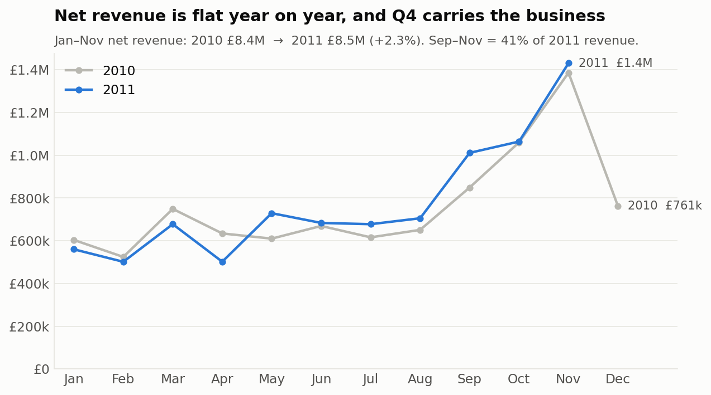
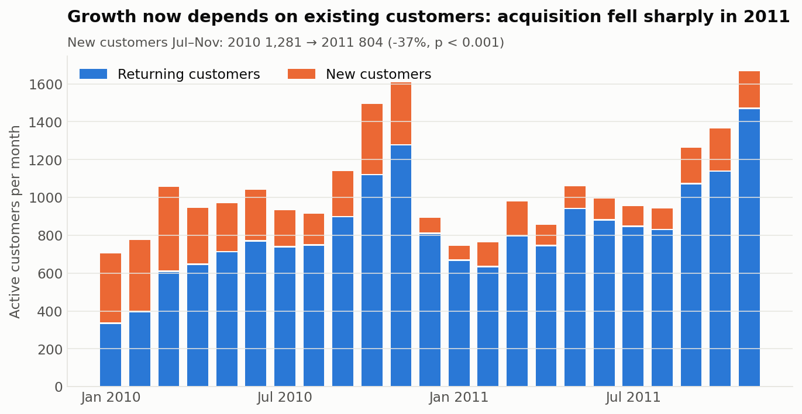
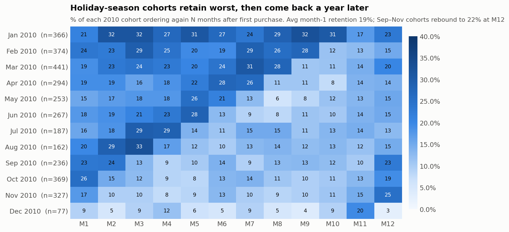
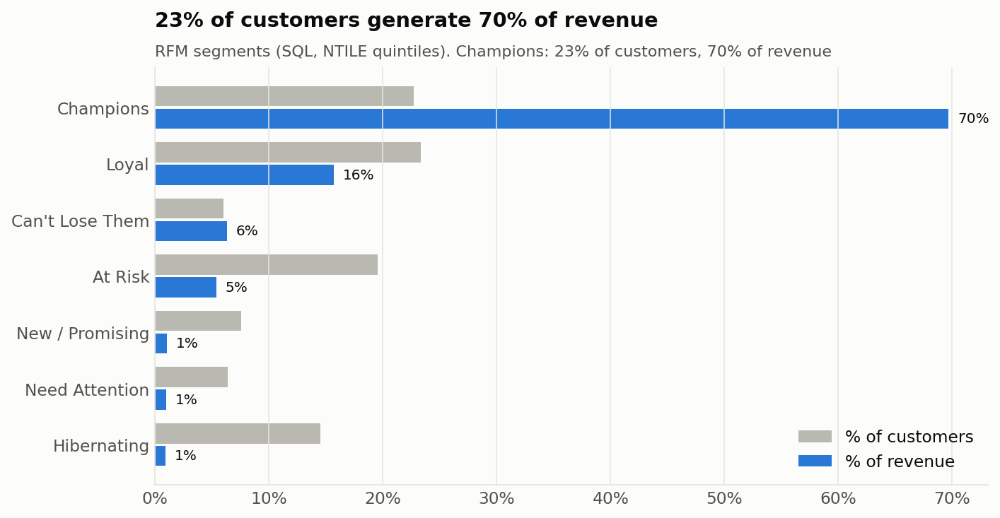
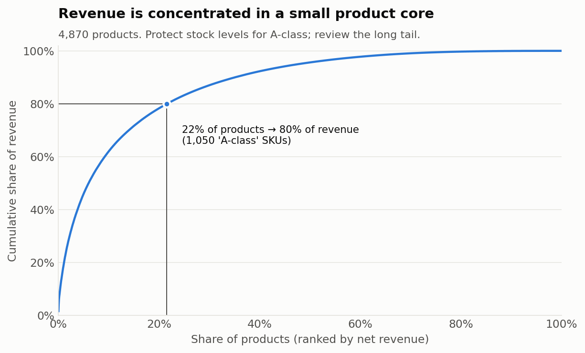
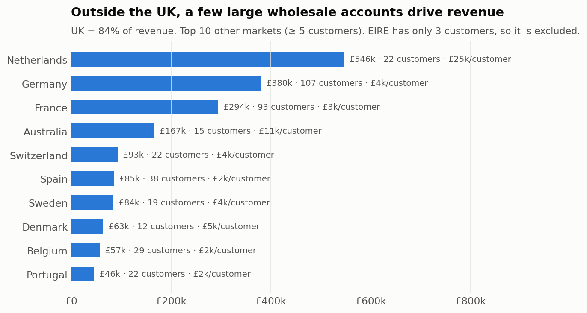
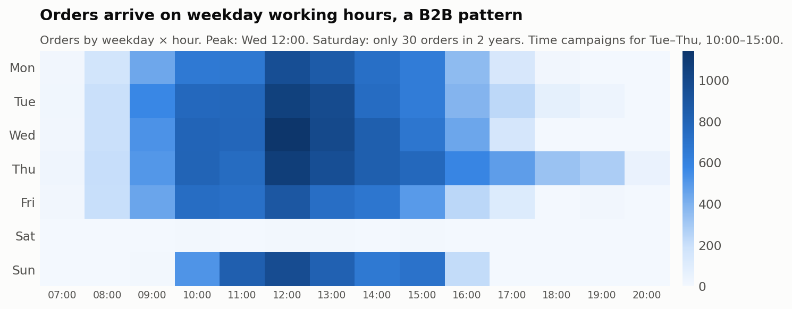
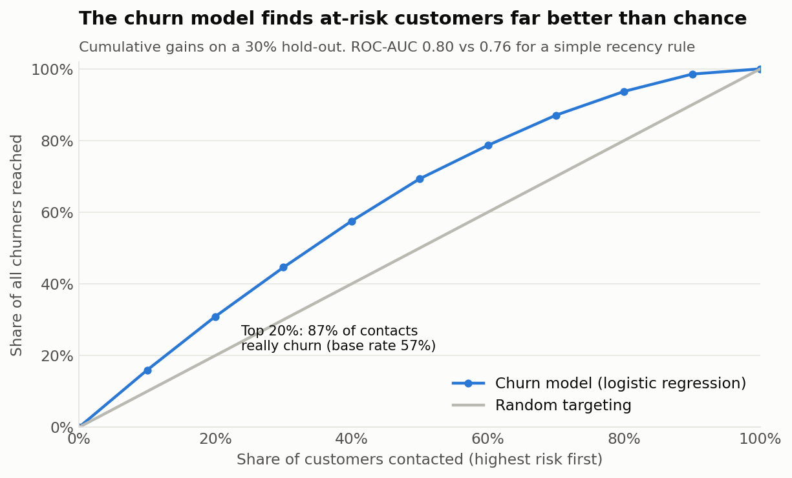

# Online Retail Analytics: Customer Retention, Segmentation & Churn Risk

**End-to-end analysis of 1.07 million real e-commerce transactions: from messy Excel to SQL, statistics, a churn model, and an interactive dashboard, ending in recommendations a business can act on.**


🔗 **[Live interactive dashboard](https://online-retail-analytics-3bcltmezhp8gz9f9dixeds.streamlit.app)** · 📊 [Power BI build guide](powerbi/POWERBI_GUIDE.md) · 🧾 [SQL queries](sql/)

---

## The business problem

A UK online gift wholesaler (most customers are small retailers) sold **£18.9M over two years** but revenue growth has stalled. Leadership asks:

1. **Where is revenue coming from, and is it growing?**
2. **Are we keeping the customers we win?**
3. **Which customers matter most, and which are we about to lose?**
4. **What should we do next, and in what order?**

## Executive summary

| # | Finding | Evidence | Recommendation |
|---|---|---|---|
| 1 | **Revenue is flat (+2.3% YoY) because new-customer acquisition fell 37%.** Existing customers are carrying the business. | 1,281 → 804 new customers (Jul–Nov 2010 vs 2011), *p* < 0.001 | Audit acquisition channels. A 37% drop in new customers is a funnel problem, not seasonality. |
| 2 | **Only 1 in 5 new customers orders again the next month.** Customers acquired in the Sep–Nov peak are less loyal still. | Month-1 retention 19%. 90-day repeat rate 36.5% for Q4 cohorts vs 42.7% for the rest of the year (χ² test, *p* = 0.001) | Run a second-order programme aimed at peak-season first-time buyers within 30 days. |
| 3 | **23% of customers ("Champions") generate 70% of revenue.** | RFM segmentation in SQL with `NTILE` | Protect this group with an account-manager or VIP tier. Losing a handful costs more than gaining hundreds of new buyers. |
| 4 | **349 high-value customers have gone quiet.** They're worth £1.04M lifetime, with a median of 337 days since their last order. | "Can't Lose Them" RFM segment | Personal win-back outreach. *Illustrative:* reactivating 10% at their historical yearly spend ≈ **£52k/year**. |
| 5 | **A churn model flags at-risk customers far better than guessing.** | ROC-AUC 0.80 on hold-out. In the top 20% risk group, 87% really churn vs a 57% base rate | Use the dashboard's call list each month. 120 valuable, recently active customers are flagged now. |
| 6 | **22% of products bring in 80% of revenue, and Sep–Nov is 41% of the year.** | Pareto/ABC analysis with SQL window functions | Prioritise stock for the 1,050 A-class SKUs before September. Build bundles from basket pairs with 30×+ lift. |

> Every number above is produced by the code in this repo. Run `python run_pipeline.py` and you get the same results.

---

## Key visuals

### 1. Revenue is flat and highly seasonal


### 2. Growth now depends on existing customers

The 2010 bars include some long-standing customers seen for the first time, because the data starts in Dec 2009 (left-censoring). That's why the significance test compares **Jul–Nov** only: by mid-2010, regular buyers have already shown up.

### 3. Cohort retention: holiday cohorts retain worst, then return a year later

The Sep–Nov 2010 cohorts drop to 10–13% by month 3, then jump back to 19–25% at **month 12**. These are seasonal gift buyers who return for the next holiday. That makes a strong case for a pre-season reminder campaign each August.

### 4. RFM segmentation


### 5. Product concentration


### 6. International markets

The Netherlands brings in £25k per customer, about 10× the UK average. These are wholesale accounts that deserve dedicated account management.

### 7. When customers buy

Orders follow office hours, there's almost no Saturday trading, and Sunday is busy, which suggests a B2B customer base. Campaign sends should be timed for Tue–Thu mornings.

### 8. Churn model


---

## Method

```
Raw Excel (2 sheets, 1,067,371 rows)
   │  src/ingest.py          read once, cache as Parquet
   ▼
Cleaning & audit             src/clean.py → data_quality_log.csv
   │
   ▼
SQLite + SQL analyses        sql/*.sql (CTEs, window functions) via src/run_sql.py
   │
   ├─► Hypothesis tests      src/hypothesis_test.py   (chi-square, binomial rate test, Wilson CIs)
   ├─► Churn model           src/churn_model.py       (time-split features, CV, gains chart)
   ├─► Market basket         src/basket.py            (support / confidence / lift, sparse matrices)
   ├─► Figures               src/figures.py
   └─► Power BI star schema  src/export_powerbi.py
                                    │
                                    ▼
                    Streamlit dashboard  app/streamlit_app.py
```

### 1. Data cleaning, with every decision logged

Raw data is messy, and handling it properly is half the job. Each rule below is applied in code and recorded in [`data_quality_log.csv`](data/processed/data_quality_log.csv):

| Rule | Rows removed | Why it matters |
|---|---:|---|
| **Sheet overlap** (1–9 Dec 2010 appears in both Excel sheets) | 22,523 | Left in, it overstates revenue by **£377k**. Easy to miss. |
| Exact duplicate lines | 11,812 | Double-scanned lines |
| Bad-debt adjustments (`A` invoices) | 6 | Accounting entries, not sales |
| Non-product codes (postage, Amazon fees, manual, vouchers) | 5,969 | Would distort product and basket analysis |
| Zero / negative price | 5,931 | Stock write-offs ("damaged", "given away") |
| **Voided order pairs** (sale + exact cancellation) | 12,360 | e.g. an 80,995-unit order cancelled 12 minutes later. It nets to £0 but would wreck average order size and product rankings. |
| **Kept:** 1,008,770 rows (94.5%) | | |

Lines without a Customer ID (22.5%) are **kept for revenue totals** and **excluded from customer-level analysis**. Dropping them would understate revenue by about a fifth.

### 2. SQL ([`sql/`](sql/))

| Query | Techniques |
|---|---|
| [`01_monthly_kpis.sql`](sql/01_monthly_kpis.sql) | Multi-CTE KPI table, `LAG(..., 12)` for YoY growth, new vs returning split |
| [`02_cohort_retention.sql`](sql/02_cohort_retention.sql) | Cohort assignment, month-index arithmetic, retention matrix |
| [`03_rfm_segments.sql`](sql/03_rfm_segments.sql) | `NTILE(5)` scoring, rule-based segment `CASE` logic |
| [`04_product_pareto.sql`](sql/04_product_pareto.sql) | Running `SUM() OVER (ORDER BY ...)`, `ROW_NUMBER`, ABC classification |
| [`05_country_performance.sql`](sql/05_country_performance.sql) | Revenue per customer, repeat rate, share of total with `SUM(SUM()) OVER ()` |
| [`06_order_timing.sql`](sql/06_order_timing.sql) | Weekday × hour demand pattern |

### 3. Statistics ([`hypothesis_tests.json`](data/processed/hypothesis_tests.json))

- **H1, peak-season customers are less loyal:** two-proportion χ² test on 90-day repeat rates for 3,276 customers acquired in 2010. Result: 36.5% vs 42.7%, *p* = 0.001, Cohen's *h* = −0.13 (a small but real effect). Wilson 95% confidence intervals don't overlap.
- **H2, acquisition fell:** conditional binomial test for equal Poisson rates, *p* < 10⁻²⁵.

### 4. Churn model ([`churn_model_summary.json`](data/processed/churn_model_summary.json))

- **No leakage:** features are built only from data before 10 Sep 2011. The label is "ordered in the next 90 days".
- **Features:** 12 behavioural features, including recency, frequency, monetary value, order cadence, product breadth, return rate and recent activity.
- **Model choice:** gradient boosting (AUC 0.797) beat logistic regression (0.793) by less than 0.01, so **logistic regression was chosen for explainability**. Both comfortably beat a simple recency rule (0.762).
- **Business framing:** the output is a ranked call list with *expected 90-day revenue at risk*, not just a probability. The list excludes customers already silent for more than 6 months, because they need a win-back campaign rather than a retention call.

---

## Interactive dashboard

The [Streamlit app](app/streamlit_app.py) has date and market filters, KPI tiles with YoY deltas, cohort and RFM views, a "frequently bought together" product lookup, and a downloadable churn call list.

The same model is also exported as a **Power BI star schema** (`fact_sales` + `dim_customer` / `dim_product` / `dim_date`), with ready-to-paste DAX measures in the [Power BI guide](powerbi/POWERBI_GUIDE.md).

## Reproduce it

```bash
git clone https://github.com/ShangChiOne/online-retail-analytics.git
cd online-retail-analytics
pip install -r requirements.txt

# Download the raw data (45 MB) from UCI and unzip into data/raw/
#   https://archive.ics.uci.edu/dataset/502/online+retail+ii
python run_pipeline.py                 # about 5 min on first run (Excel parsing), then about 1 min
streamlit run app/streamlit_app.py
```

The cleaned dataset (`data/processed/transactions.parquet`, 8 MB) is committed, so **the dashboard runs without the raw download**.

## Repository structure

```
├── app/streamlit_app.py        interactive dashboard
├── sql/                        all SQL analyses (SQLite dialect)
├── src/                        pipeline steps (ingest → clean → SQL → stats → model → figures → export)
├── data/processed/             cleaned data + every analysis output (CSV / JSON)
├── reports/figures/            charts used in this README
├── powerbi/                    star-schema tables + Power BI build guide with DAX
└── run_pipeline.py             one command to rebuild everything
```

## Limitations & next steps

- **No cost or margin data:** recommendations are revenue-based. With COGS, the RFM and churn value would use profit.
- **Left-censored history:** the data starts Dec 2009, so the first cohort mixes new and long-standing customers. This is handled by excluding it from retention tests.
- **Mostly B2B wholesale:** findings apply to small-retailer buyers, not consumers.
- **No marketing data:** the acquisition drop can be detected but not attributed to a channel. That's the obvious next data request.
- **Next:** A/B test the second-order programme (power analysis for ~6pp uplift on a 37% base needs about 1,000 customers per arm), and build a CLV model (BG/NBD + Gamma-Gamma).

## Data source

Chen, D. (2012). *Online Retail II* [Dataset]. UCI Machine Learning Repository. https://doi.org/10.24432/C5CG6D, licensed under [CC BY 4.0](https://creativecommons.org/licenses/by/4.0/).
